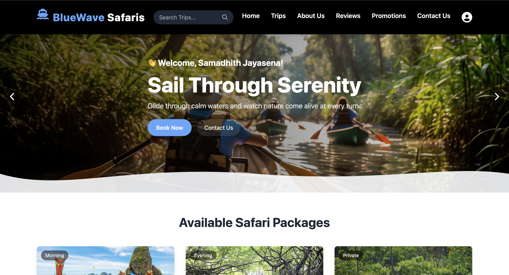

# 🚤 Boat Safari & Trip Management System



A web-based Boat Safari Trip Management System developed as a **six-member group project** for the Software Engineering (SE2030) module at the **Sri Lanka Institute of Information Technology (SLIIT)**.

The system aims to streamline boat safari operations by providing a centralized platform for tourists, administrators, booking managers, tour guides, boat drivers, and marketing coordinators.

## 📌 Project Overview

Managing boat safari trips involves coordinating bookings, trip schedules, boat resources, payments, promotions, and customer interactions.

Our system addresses these operational requirements through a web-based application that provides role-based functionality for different stakeholders, helping improve the efficiency of safari trip management and the overall customer experience.

## 🛠️ Technologies Used

| Technology | Purpose |
|---|---|
| Java | Backend development |
| Spring Boot | Backend application framework |
| HTML5 | Web page structure |
| CSS3 | Styling and layout |
| JavaScript | Client-side functionality |
| MySQL | Database management |
| MySQL Workbench | Database administration |
| Maven | Project build and dependency management |
| IntelliJ IDEA | Development environment |

### Architecture & Design Patterns

- **MVC Architecture (Model-View-Controller):** Separates application logic, user interface, and data management.
- **Strategy Design Pattern:** Used to handle promotion/discount calculation and payment validation logic through flexible strategies.

## ✨ Key Features

### 👤 Tourist Management
- Browse available boat safari trips.
- View trip information and details.
- Make safari trip bookings.
- Manage and cancel bookings.
- Access tourist-related information.

### 📅 Trip & Resource Management
- Create, update, view, and delete trip information.
- Manage trip schedules.
- Organize boat and resource allocation.

### 💳 Booking & Payment Management
- Handle tourist bookings.
- Manage booking information.
- Support payment validation logic.

### 🎁 Promotions & Discounts
- Create and manage promotional offers.
- Apply discounts to eligible bookings.
- Calculate discounts using the Strategy Design Pattern.

### 👥 Role-Based Management

The system supports multiple stakeholders with dedicated functionalities:

- Administrator
- Tourist
- Booking Manager
- Boat Driver
- Tour Guide
- Marketing Coordinator

### ⭐ Feedback & Notifications
- Manage customer feedback and reviews.
- Support notification functionality.
- Manage user sessions.

## 🏗️ System Architecture

The application follows the Model-View-Controller (MVC) architectural pattern.

The main components include:

- **Model:** Handles application data and business entities.
- **View:** Provides the user interface for interacting with the system.
- **Controller:** Processes user requests and coordinates application operations.

This separation helps maintain organized code and improves application maintainability.

## 🧠 Design Pattern Implementation

### Strategy Design Pattern

We implemented the Strategy Design Pattern to provide flexible handling of different business operations.

It is applied to:

1. **Promotion and Discount Calculation:** Supports different discount calculation strategies.
2. **Payment Validation:** Supports different payment validation strategies.

This approach helps reduce tightly coupled conditional logic and makes it easier to introduce additional strategies.

## 👨‍💻 My Contribution

This project was developed collaboratively by a team of six members.

My primary responsibility was the **Tourist Stakeholder Module**.

My contributions included:

- Developing trip browsing functionality.
- Implementing the tourist booking flow.
- Performing tourist-related CRUD operations.
- Working on booking management interactions.
- Improving the tourist user experience.

Through this module, I gained practical experience in developing user-facing web application features and integrating frontend functionality with backend services.

## ⚙️ Installation & Setup

Follow these steps to run the project locally.

### Prerequisites

Make sure you have installed:

- Java Development Kit (JDK)
- IntelliJ IDEA
- MySQL Server
- MySQL Workbench (optional)
- Git

### 1. Clone the Repository

```bash
git clone https://github.com/IT24100816/Boat-Safari-Trip-Management-System.git
```

### 2. Open the Project

- Open IntelliJ IDEA.
- Select **Open**.
- Choose the cloned project folder.
- Allow Maven to download the required dependencies.

### 3. Configure the Database

- Start your MySQL Server.
- Create a MySQL database.
- Configure the database connection details in the application's configuration file (`application.properties`).

Update the database URL, username, and password according to your local MySQL configuration.

Example:

```properties
spring.datasource.url=jdbc:mysql://localhost:3306/your_database_name
spring.datasource.username=your_username
spring.datasource.password=your_password
```

### 4. Run the Application

You can run the project using IntelliJ IDEA or the Maven wrapper.

For macOS/Linux:

```bash
./mvnw spring-boot:run
```

For Windows:

```bash
mvnw.cmd spring-boot:run
```

Once the application starts successfully, access it using the configured application URL and port.

**Note:** Database configuration and any required initial data must be set up before running the application.

## 🎓 Academic Information

| Detail | Description |
|---|---|
| University | Sri Lanka Institute of Information Technology (SLIIT) |
| Module | Software Engineering |
| Module Code | SE2030 |
| Academic Level | Year 2 – Semester 1 |
| Project Type | Group Project |
| Team Size | 6 Members |

## 👨‍👩‍👧‍👦 Team

This project was collaboratively developed by a team of six undergraduate students as part of the SE2030 Software Engineering module.

Each team member contributed to different stakeholder modules and system functionalities.

## 📚 Learning Outcomes

Through this project, we gained practical experience in:

- Java and Spring Boot application development.
- MVC architectural implementation.
- MySQL database integration.
- CRUD operation development.
- Applying software design patterns.
- Collaborative software development.
- Team coordination and Agile-based development practices.

## 📂 Repository

**GitHub:** [Boat Safari & Trip Management System](https://github.com/IT24100816/Boat-Safari-Trip-Management-System)

## 📄 License

This project is licensed under the MIT License. See the [LICENSE](LICENSE) file for details.

---

⭐ Developed as a collaborative academic project for the SE2030 Software Engineering module at SLIIT.
